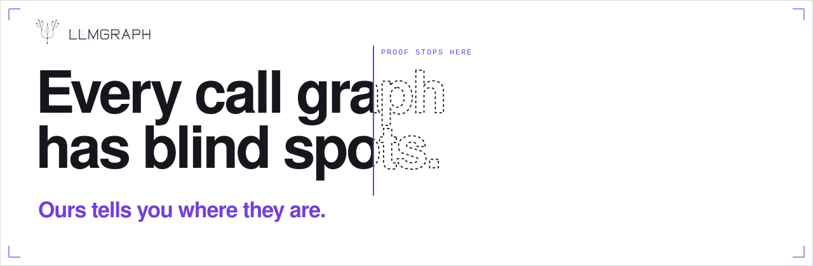

<picture>
  <source media="(prefers-color-scheme: dark)" srcset="assets/banner-blindspots-dark.svg">
  
</picture>

# LLMGRAPH

**Every call graph has blind spots. Ours tells you where they are.**

LLMGRAPH inks only the calls it can prove. The ones it can't see, it counts and names in plain words, so your agent sees the blind spots before it edits.

I built LLMGRAPH as the truth layer for coding agents, and the truth includes the blind spots: agents guess; LLMGRAPH proves what it can and names what it can't. **In a blind test of 50 questions on three open-source repos, no confident answer was wrong.**

---

## Two functions. One name. Your agent can't tell. We can.

grep reads names. LLMGRAPH follows calls. What it can prove, it proves; what it can't, it tells you, down to the line where it stopped.

zod ships two copies of `addIssueToContext`. A text search mixes them together:

```text
$ rg -n addIssueToContext      # zod v3.23.8
146 lines, from both copies, mixed together
```

LLMGRAPH separates them, and shows its work:

```text
llmgraph · who_calls addIssueToContext (src/helpers/parseUtil.ts:72): 71 in a set
  ⚠︎ type checker starting: answers use our own reading for now; 71 calls unchecked
  ◇ within_these 71 calls -> one of 1 (closed: repo only) [c] w1
  ⚠︎ plus 7 dynamic calls nearby that could reach anything w2
  – ruled out: 71 same-name calls (proven: other target) [c] w3
  assumes [c]: our own reading, not confirmed by the checker
(lines trimmed)
```

**71 look-alikes ruled out, and it shows why.** And where the type checker hasn't confirmed yet, it says so.

## Who's holding the other end?

Before your agent pulls a thread, it should know. In requests, change `super_len(o)` to `super_len(o, strict)`, and ask `check_my_changes`:

```text
llmgraph · check_my_changes: 1 file changed, 16 calls break
  16 breaks: misses "strict" w1
  ⚠︎ breaks if it runs super_len src/requests/models.py:526 PreparedRequest.prepare_body (within_these, one of 1, closed: repo only) [c] w2
  ⚠︎ breaks if it runs super_len src/requests/models.py:575 PreparedRequest.prepare_content_length (within_these, one of 1, closed: repo only) [c] w3
  ⚠︎ breaks if it runs super_len tests/test_utils.py:62 TestSuperLen.test_io_streams (within_these, one of 1, closed: repo only) [c] w4
  … 13 more test call sites
  ⚠︎ plus 9 dynamic calls nearby that could reach super_len w18
(lines trimmed)
```

**16 broken calls named, exactly the real ones.** A blind tester's text search found the same 16, no more and no fewer. And the 9 dynamic calls it can't follow are marked, not ignored.

Then the type checker catches up. Ask again a few seconds later:

```text
llmgraph · who_calls super_len (src/requests/utils.py:135): 16 certain
  ✓ certain src/requests/models.py:526 PreparedRequest.prepare_body w33
  +1 more (all certain, same file) w34
  ✓ certain tests/test_utils.py:62 TestSuperLen.test_io_streams w35
  +13 more (all certain, same file) w36
  ⚠ plus 9 dynamic calls nearby that could reach anything w37
(lines trimmed)
```

**From "our own reading" to 16 `certain`, on the released program.** Its labels never say more than it has proven, and they upgrade the moment it can.

## The five labels

Other tools sketch your codebase from rumour and fill the blind spots with confidence. LLMGRAPH works in two colours: ink for what it has proven, a plain warning for what it hasn't, and never one dressed up as the other.

| Label | What it means |
|---|---|
| `certain` | We can prove it is exactly one function. |
| `exactly_these` | A known set, and every member really can run here. |
| `within_these` | One of a known list; some listed may never happen here. |
| `maybe_more` | There are candidates, but the door is open. |
| `cannot_see` | Nothing to go on. |

Answers carry no numbers about chance; they say what is ruled out.

## Measured on our test projects

Callers are confirmed by the type checker in under a second after your agent asks (Python), and `check_my_changes` answers in under a second once LLMGRAPH has caught up with a save. On names that also appear in unrelated code, it named no wrong callers where a plain text search returned hundreds of wrong lines, and the agent read less than half as many tokens; on clean, unique names there is no saving.

How we measured, the raw data, and where LLMGRAPH loses: [BENCHMARKS.md](BENCHMARKS.md).

## What your agent can ask

| Tool | What it answers |
|---|---|
| `who_calls` | Every place that calls this function, plus calls we can't see. |
| `what_breaks_if_changed` | Everything that depends on this, directly or indirectly, and what we can't see. |
| `check_my_changes` | After editing: callers you didn't update, and anything we can't see. |
| `what_is_unknown` | Where our view is blind (dynamic calls, unknown types, unreadable files) and why. |
| `explain` | Why we said this: the evidence behind one answer line. |

Your code is read and analysed on your machine, and we never receive your code, paths, symbol or repo names, queries or answers. Checked on the released program: it contacts only beta.llmgraph.in. Usage counts and crash reports are on by default and can be switched off (`npx -y llmgraph-mcp telemetry off`); the licence check is always on. [Privacy page](https://beta.llmgraph.in/privacy/).

## Install

**Claude Code (plugin):**

```bash
claude plugin marketplace add brainfoods-studio/llmgraph-agent-plugin
claude plugin install llmgraph@llmgraph
```

The plugin offers LLMGRAPH's answer before your agent searches for a function or class name, and never blocks the search. When your agent is about to finish, it stops it once if the saved edits left calls that are `certain` to break, and lists them; it never blocks on anything less, and `npx -y llmgraph-mcp hook off` turns both off.

**Any MCP agent:** add the server `npx -y llmgraph-mcp` (on Windows some agents need `cmd /c npx -y llmgraph-mcp`), sign in once with Google, and your agent asks. [Setup guides](https://beta.llmgraph.in/docs/start/) for Claude Code, Antigravity, Cursor, Codex, Gemini CLI, Windsurf and OpenCode; tested by us on Claude Code and Antigravity.

**Today's limits:** Windows x64 · Python and TypeScript/JavaScript (other languages are reported as `cannot_see`, not counted as nothing) · repos up to the plan's line limit · invite-only beta, [request an invite](https://beta.llmgraph.in/) · one plan for individuals with a trial, [prices](https://beta.llmgraph.in/pricing/).

This repo holds the open setup files under MIT; **the LLMGRAPH engine is closed source** and runs on your machine under the [EULA](https://beta.llmgraph.in/eula/). Brainfoods Studio, India · founder@llmgraph.in · security@llmgraph.in
